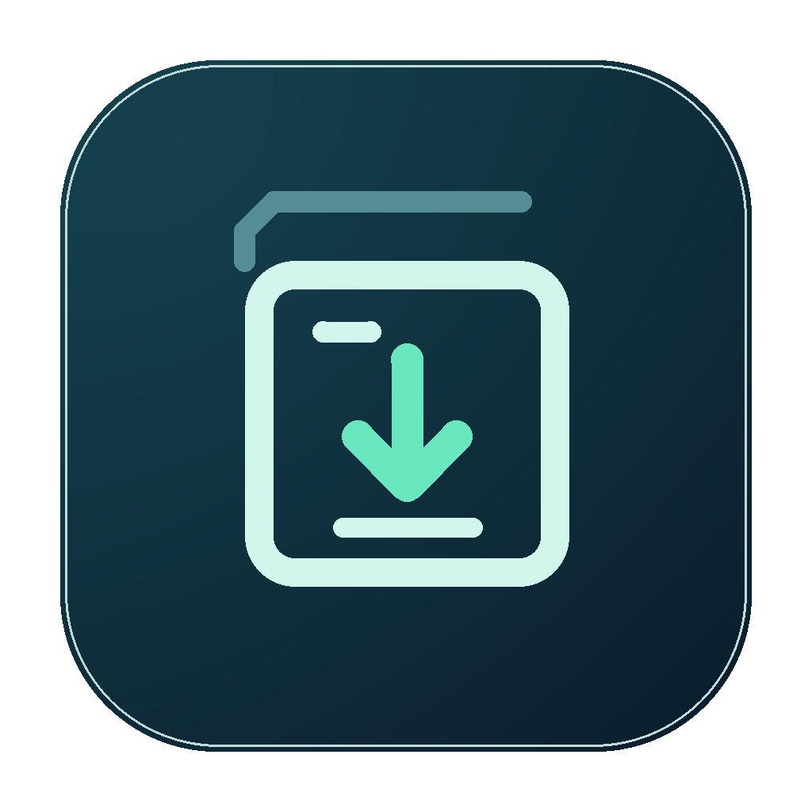
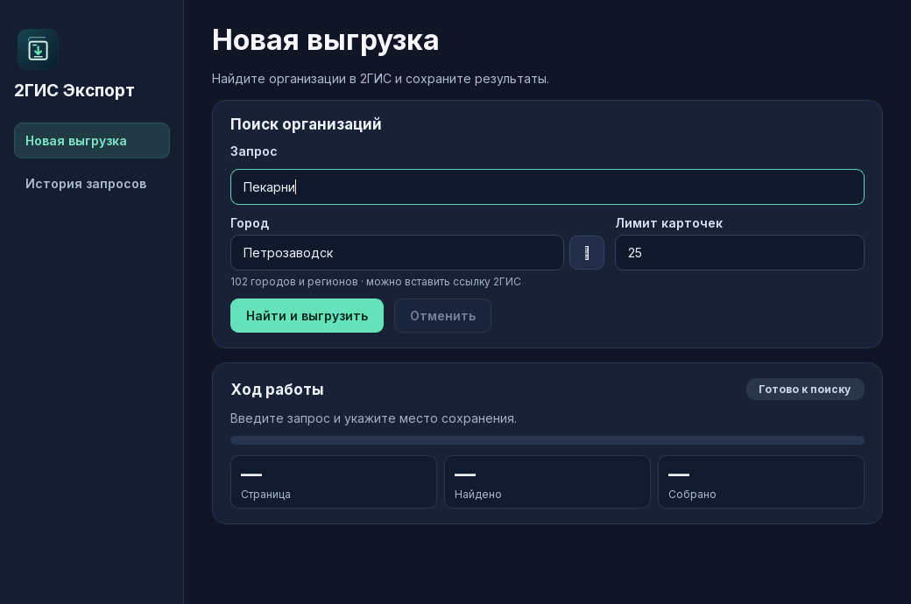

<p align="center">
  
</p>

<h1 align="center">2ГИС Экспорт</h1>

<p align="center">Поиск организаций в 2ГИС и выгрузка в Excel или CSV.<br>Нативное приложение для Windows и macOS и отдельный Python-скрипт.</p>

<p align="center">
  <a href="https://github.com/jaFuart/2gis-desktop/releases/latest"><strong>Скачать приложение</strong></a> ·
  <a href="#работа-с-выгрузкой">Работа с выгрузкой</a> ·
  <a href="#отдельный-python-скрипт">Python CLI</a>
</p>



- **Поиск по городу** с автодополнением по 102 городам и регионам. В поле города можно вставить ссылку 2ГИС.
- **Прогресс в реальном времени** с текущей страницей и счётчиками карточек, отменой после подтверждения и сохранением частичного результата.
- **Локальная история** с повторным запуском запросов и доступом к сохранённым файлам.
- **Текстовые ячейки XLSX** сохраняют исходное написание телефонов, рейтингов и часов работы.

Desktop app and standalone Python CLI for exporting 2GIS business search results to XLSX or CSV.

## Запуск приложения

В разделе [Releases](https://github.com/jaFuart/2gis-desktop/releases/latest) доступны архивы для Windows x64, macOS Apple Silicon и macOS Intel. Для фонового сбора нужен установленный Google Chrome.

- **Windows** — распакуйте архив целиком и запустите `2GIS-Export.exe`.
- **macOS** — распакуйте архив своего процессора и запустите `2GIS-Export.app`. Пакет собирается без нотариального заверения Apple.

При первом поиске может потребоваться загрузить подходящий ChromeDriver. Окно браузера при сборе скрыто.

## Работа с выгрузкой

1. Введите запрос и начните набирать название города. Список из 102 городов и регионов России работает без загрузки при запуске. Если нужного города нет, введите короткий код из ссылки 2ГИС или вставьте ссылку в поле города. [Источник городов и регионов](https://info.2gis.ru/ussuriisk/products/moduls)
2. Нажмите **Найти и выгрузить** и выберите новый файл `.xlsx` или `.csv`. Если лимит пустой, сбор идёт до конца доступной выдачи.
3. По ходу выгрузки приложение показывает текущий этап, страницу и количество найденных и собранных карточек.
4. **Отменить** останавливает сбор после подтверждения. Приложение сохраняет уже собранные строки. Если браузер завис, через 30 секунд завершает рабочий процесс и сохраняет полученную к этому моменту часть.
5. Во вкладке **История** можно открыть файл или перенести параметры прошлого запроса в форму. История хранится локально в SQLite и сохраняется между запусками.

Статусы различают завершённую выгрузку, частичный результат, отсутствие результатов, отмену и ошибку. При ограничении доступа к выдаче сохранённый частичный файл можно открыть из истории.

Ячейки XLSX имеют текстовый тип. Это сохраняет `4.8`, `+7…` и часы работы при открытии в Excel. Ячейка остаётся пустой, если значение не получено. Телефоны ищутся в контактах конкретной карточки, включая случаи с несколькими опубликованными номерами.

## Запуск из исходников

Нужны Python 3.11 или 3.12 и Chrome. Qt Widgets устанавливается вместе с зависимостями приложения.

```shell
python -m pip install -r requirements.txt
python app.py
```

История и драйверы находятся в `%LOCALAPPDATA%\2GIS Export` на Windows и в `~/Library/Application Support/2GIS Export` на macOS. Исходники, настройки и выгрузки не отправляются в этот репозиторий автоматически.

## Отдельный Python-скрипт

Для командной строки достаточно файла [parse_2gis.py](parse_2gis.py) и SeleniumBase.

```shell
python -m pip install seleniumbase==4.47.9
python parse_2gis.py --uc --city gornoaltaysk --query "Кафе в Горно-Алтайске" --pages 4 --output cafes.xlsx
python parse_2gis.py --help
```

Поддерживаются режимы `browser`, `api` и `hybrid`. Для двух последних задайте `TWOGIS_API_KEY`. Флаг `--headed` у скрипта показывает окно Chrome при необходимости, а `--ground-stops stops.txt` позволяет заполнить недостающие наземные остановки отдельным справочником.

## Сборка и тесты

Чтобы собрать приложение и прогнать тесты, выполните команды на целевой ОС.

```shell
python -m pip install -r requirements.txt pyinstaller==6.22.3
python -m unittest discover -s tests -v
python build.py
```

Приложение появится в `dist`. Готовый бинарник включает Python. Сборку нового релиза можно запустить в **Actions → Desktop builds**, указав новый тег. [Документация PyInstaller](https://www.pyinstaller.org/en/stable/usage.html)

Уведомления о поставляемых библиотеках находятся в папке `licenses`. Интерфейс использует Qt Widgets через PySide6 Essentials. [Документация Qt](https://doc.qt.io/qtforpython-6/PySide6/QtWidgets/)
